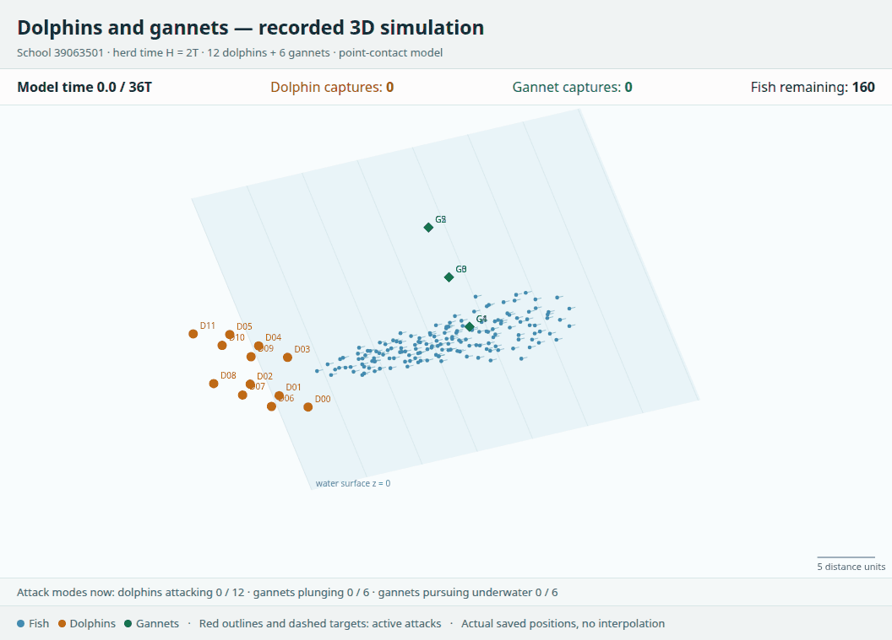

# FishSim: dolphin–gannet pilot

Saved simulations, 3D replays and reproducible analysis of dolphin–gannet feeding around a fish school.

## Watch a recorded 3D encounter

[](docs/media/dolphins-gannets-2026-11-09.webm)

**12 dolphins · 6 gannets · H=2T · 160 initial fish.** This shows the entire saved 0–36T encounter from run `s39063501_H2_G6_DG_c61001`, in about 30 seconds of playback. Orange markers are dolphins, green markers are gannets and blue markers are fish. The clock, capture counters, attack states and water surface remain visible.

[Full video (WebM)](docs/media/dolphins-gannets-2026-11-09.webm) · [Recording settings and source hashes](docs/media/dolphins-gannets-2026-11-09.json)

The recording uses actual saved positions. T is uncalibrated model time; marker size is schematic. No simulation, predator behaviour or capture probability was changed for this recording.

## Start here

| Task | Entry point |
| --- | --- |
| Watch and compare saved runs in 3D | `python tools/watch_replays.py` · [Viewing guide](docs/VISUALISATION.md) |
| Reproduce the current paper’s figures and tables | [main.ipynb](main.ipynb) |
| Read the current paper | [Working draft PDF](reports/current/Feeding_Frenzy_Working_Draft.pdf) |
| Review all findings, assumptions and experimental conditions | [Scientific overview](docs/STUDY_OVERVIEW.md) |
| Find code, data, archives and validation records | [Repository guide](docs/REPOSITORY_GUIDE.md) |

## Open the interactive 3D viewer

From a terminal in the repository root:

```bash
python -m pip install -r requirements-analysis.txt
python tools/watch_replays.py
```

The script opens a local browser viewer covering **108 saved encounters**, including the 9/12/18-gannet extension. This viewer catalogue remains that validated subset; the current paper and bundled raw data additionally include the completed 24/36-bird extension. Select individual runs or compare A/B, inspect their settings and capture returns, then play, pause or scrub the shared clock. Switch between 3D, top and side views; drag the 3D view to rotate it. Dolphins, gannets and individual capture counters are shown together.

This reads bundled recordings and starts no simulation. It needs no native FishSim binary. For a remote/headless machine or a specific port, see the [viewing guide](docs/VISUALISATION.md).

## Run the analysis notebook

Open **[main.ipynb](main.ipynb)** in JupyterLab and choose **Run → Run All Cells**. Viewing instructions are also in its opening cell.

```bash
python -m jupyterlab
```

The default ten code cells reproduce four figures and nine summary tables from saved results. They take zero native simulation steps and generate no new bootstrap draws. Optional model examples remain disabled. [Detailed setup and platform notes](docs/STUDY_OVERVIEW.md#local-setup-current-paper-analysis-and-figures).

## What this study currently shows

The current paper includes a complete H × gannet-count map through thirty-six gannets, using four previously observed schools. Some settings improve feeding returns for both species; others do not. A separate selected-regime check with 24 dolphins retains positive mean partner benefits but lowers catches per dolphin compared with 12 dolphins. Results from that discovery map, the original pilots and the separate timestep checks are distinguished in the [scientific overview](docs/STUDY_OVERVIEW.md), with every setting and sign retained.

These are model results with exploratory uncertainty, unresolved timestep sensitivity and uncalibrated physical units. They do not establish general biological cooperation or numerical convergence.

A separate [higher-count accessibility supplement](reports/supplements/HIGH_COUNT_ACCESSIBILITY.md) examines potential prey-access windows in all128 saved bird-bearing encounters. It retains all24 conditions and adds no simulations or schools; the current paper and notebook remain unchanged.

Active validation: the [frozen pre-analysis plan and 192 planned case identities](reports/supplements/VALIDATION_PREANALYSIS_PLAN.md) describe the separate 16-school study. This public archive is posted after feeding began and reports no validation effects. The current paper remains the earlier discovery report.

The [first independently audited paired48 progress snapshot](reports/supplements/VALIDATION_PROGRESS_48.md) covers four of those schools, both nested labels and both timesteps. Mean feeding changes are positive for both species in this block, while individual school losses remain visible. It is descriptive only; all192 encounters and the final primary analysis remain mandatory.

A [prospective H2/G12 follow-up and four-endpoint programme addendum](reports/supplements/LOWER_COUNT_FOLLOWUP_PLAN.md) uses the same 16 schools. It is planned but not authorised for native execution and leaves the active H1/G36 primary analysis unchanged.

A [prospective crossed follow-up](reports/supplements/CROSSED_FOLLOWUP_PLAN.md) proposes H1/G12 and H2/G36 to separate the two tested herding durations and bird counts. Its 128 new mixed encounters would reuse exact controls on the same 16 schools; execution waits for both complete 192-case audits and fresh authority.

## Model execution and repository history

New simulations are separate from replay and default notebook analysis. Read [V6_MODEL_SETUP.md](V6_MODEL_SETUP.md) for bounded parameter-map examples, [CURRENT_MODEL_SETUP.md](CURRENT_MODEL_SETUP.md) for the coarse/fine replication runner, or [NATIVE_SETUP.md](NATIVE_SETUP.md) for the historical runner.

Earlier generated exports and the old delivery receipt are grouped under [archive/](archive/README.md). Hash-pinned source, data and historical filenames remain intact because the notebook checks their exact paths. The [repository guide](docs/REPOSITORY_GUIDE.md) identifies the files needed for everyday use. Third-party notices remain in [PROVENANCE.md](PROVENANCE.md).
