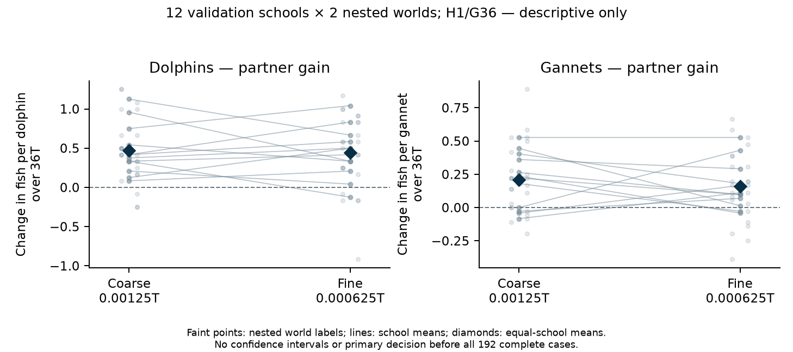

# Validation progress: first twelve audited schools

**Preliminary: 12 of 16 prespecified new schools, 144 of 192 full encounters.** On the fine grid, dolphin captures increased from 542 to 670 (+23.6%) and gannet captures from 234 to 372 (+59.0%). Both species also had higher mean captures on the coarse grid. These cumulative results are descriptive, with no confidence intervals or primary decision. All remaining cases continue regardless of the signs. The current paper and notebook remain the separate completed discovery report.

The fixed H1/G36 model uses twelve dolphins, thirty-six gannets, 160 starting fish, q=0.7 eligible oral-contact success and nominal 36T encounters. Schools 39065501–39065512 each have two matched randomness labels (71001/71002), three arms (D-only, G-only, mixed) and both grids. Labels change capture, tie and bird-target streams while readiness stays fixed by school/identity. They are nested repeats: the independent unit is the school, not twenty-four worlds, individual predators or 144 executions. Discovery schools are not pooled.

## Matched food counts

Each total combines twenty-four labelled encounters for that species, arm and grid. Per-individual gains first average the two labels within each school, then give all twelve schools equal weight. Percentages are ratios of matched aggregate counts, not averages of school percentages. SD describes the spread of the twelve school-mean gains; it is not a confidence interval.

| Grid | Species | Alone captures | Mixed captures | Change | Gain per individual over 36T | Relative change | School SD of gain |
|---|---|---:|---:|---:|---:|---:|---:|
| coarse | Dolphins | 526 | 662 | +136 | +0.472222 | +25.9% | 0.321933 |
| coarse | Gannets | 166 | 345 | +179 | +0.207176 | +107.8% | 0.206809 |
| fine | Dolphins | 542 | 670 | +128 | +0.444444 | +23.6% | 0.323400 |
| fine | Gannets | 234 | 372 | +138 | +0.159722 | +59.0% | 0.176330 |

Coarse dt is 0.00125T; fine dt is 0.000625T. The fine grid was designated primary before feeding, and both grids are retained here. Travel, failed contacts and recovery remain in the nominal 36T denominator. None of these encounters depleted its fish population. The [four-panel view](../../validation_progress/primary_192_2026-11-10/prefix_144/absolute_and_partner.png) separates absolute per-animal food from matched partner gains.

## All twelve school means

After averaging each school’s two labels, fine-grid dolphin means are positive in 11 schools and negative in one; gannet means are positive in ten and negative in two. Both species have positive means in 9/12 fine-grid comparisons. On the coarse grid, dolphin means are positive in all twelve schools; gannet means are positive in eight, tied in one and negative in three, giving 8/12 joint-positive comparisons. Individual labelled encounters also include losses. These counts are descriptive and are not the prespecified final criterion.

| School | Dolphin gain: coarse | Dolphin gain: fine | Gannet gain: coarse | Gannet gain: fine |
|---|---:|---:|---:|---:|
| 39065501 | +0.125000 | +0.500000 | +0.236111 | -0.041667 |
| 39065502 | +0.541667 | +0.333333 | -0.083333 | +0.111111 |
| 39065503 | +0.333333 | +0.416667 | -0.041667 | +0.166667 |
| 39065504 | +0.083333 | +0.208333 | +0.527778 | +0.527778 |
| 39065505 | +0.416667 | +0.583333 | -0.027778 | +0.069444 |
| 39065506 | +0.958333 | +0.333333 | +0.402778 | +0.180556 |
| 39065507 | +0.416667 | +0.833333 | +0.222222 | +0.097222 |
| 39065508 | +0.208333 | +0.041667 | +0.180556 | -0.027778 |
| 39065509 | +0.375000 | +0.500000 | +0.000000 | +0.430556 |
| 39065510 | +0.750000 | +1.041667 | +0.444444 | +0.013889 |
| 39065511 | +0.333333 | -0.125000 | +0.263889 | +0.097222 |
| 39065512 | +1.125000 | +0.666667 | +0.361111 | +0.291667 |

Faint points show nested labels, lines connect school means and diamonds show equal-school means. There are no confidence bars. The [school table](../../validation_progress/primary_192_2026-11-10/prefix_144/paired_school_means.csv) and [both-label table](../../validation_progress/primary_192_2026-11-10/prefix_144/nested_world_effects.csv) retain every point and sign. Earlier [48-case](VALIDATION_PROGRESS_48.md) and [96-case](VALIDATION_PROGRESS_96.md) snapshots remain unchanged.

Fine-grid pooled dolphin contacts increased from 808 to 993, and gannet contacts from 326 to 530, with q=0.7 unchanged. These opportunity counts accompany the feeding gains; they do not isolate a panic or timing mechanism. The [independent arithmetic receipt](../../validation_progress/primary_192_2026-11-10/prefix_144/evidence/root_independent_arithmetic.json) retains both grids.

## Verification and remaining work

The independent audits for all three complete paired blocks passed raw/physical/private-stream/zero-start/removal checks; block1 also binds all six strict 4T engineering prefixes. The frozen reporting gate required the complete audit chain, all six completed owner phase tables and the 2,127 frozen source bindings. No unfinished school is included. The [inspection archive](../../validation_progress/primary_192_2026-11-10/prefix_144/README.md) contains exact audited rows, phase tables and receipts, plotted data, both figures and source fingerprints. It is not a complete portable raw-simulator bundle. Reporting used no simulator import, native steps or new bootstrap draws.

Four schools and 48 encounters remain mandatory. The locked fine-grid 97.5% primary criterion is assessed only after all 192 cases and independent FINAL acceptance; the final metadata-sidecar proof is also required before final publication. No setting, grid, school, interval method or stopping rule is selected from these interim results. The [public pre-analysis plan](VALIDATION_PREANALYSIS_PLAN.md) remains unchanged.

The selected discovery setting’s 45.1% dolphin gain came from a different four-school bank with one randomness label. The current 23.6% fine-grid gain is a separate, incomplete validation estimate, not replication of that numerical percentage. Historical discovery, older numerical checks and the new validation cohort remain distinct. This update does not establish completed validation, numerical convergence or biological generality.
