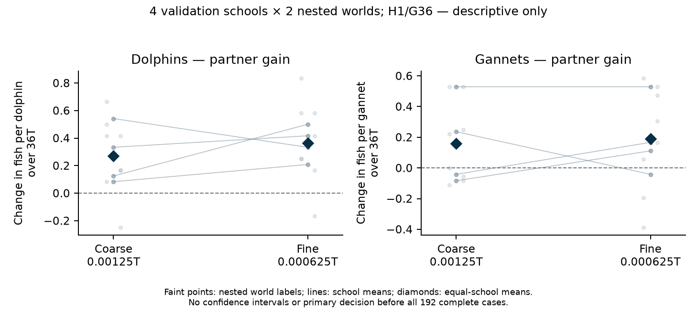

# Validation progress: first audited paired block

**Preliminary: 4 of 16 prespecified new schools, 48 of 192 full encounters.** Both species have higher average captures with the other species in this block at both timesteps. These are descriptive results; no confidence interval, primary decision or stopping conclusion is available. All remaining cases continue regardless of these signs. The current paper and notebook remain the separate completed discovery report.

This is fixed H1/G36: twelve dolphins, thirty-six gannets, 160 starting fish, q=0.7 eligible oral-contact success and nominal 36T encounters. The four schools 39065501–39065504 each have two matched stochastic-world labels 71001/71002, three arms (D-only, G-only, mixed) and both grids. Labels change capture, tie and bird-target streams while readiness stays fixed by school/identity. They are nested repeats; the independent unit is the school, not eight worlds, individual predators or 48 executions. No discovery school is pooled.

## Matched food counts

Each total below combines eight labelled encounters for that species/arm/grid. Relative changes are ratios of matched aggregate counts; per-individual gains average the two labels within each of four schools.

| Grid | Species | Alone captures | Mixed captures | Change | Fish gained per individual over36T | Relative change |
|---|---|---:|---:|---:|---:|---:|
| coarse | Dolphins | 176 | 202 | +26 | +0.270833 | +14.8% |
| coarse | Gannets | 58 | 104 | +46 | +0.159722 | +79.3% |
| fine | Dolphins | 180 | 215 | +35 | +0.364583 | +19.4% |
| fine | Gannets | 66 | 121 | +55 | +0.190972 | +83.3% |

Coarse dt is0.00125T; fine dt is0.000625T. The fine grid was designated primary before feeding; both grids are retained here. Absolute per-animal food and partner gains are shown separately in the [four-panel view](../../validation_progress/primary_192_2026-11-10/prefix_48/absolute_and_partner.png). Percentages are not means of school percentages. Travel, failed contacts and recovery remain in the nominal36T denominator; this block has no prey depletion.

## All four school means

Gain is fish per individual over36T, after averaging both labels within a school. Gannet losses remain visible: two schools have negative gannet means on the coarse grid and one on the fine grid. Dolphin means are positive in all four schools on each grid. Both species have positive school means in two of four coarse and three of four fine comparisons; these counts are descriptive, not the prespecified final criterion.

| School | Dolphin gain: coarse | Dolphin gain: fine | Gannet gain: coarse | Gannet gain: fine |
|---|---:|---:|---:|---:|
| 39065501 | +0.125000 | +0.500000 | +0.236111 | -0.041667 |
| 39065502 | +0.541667 | +0.333333 | -0.083333 | +0.111111 |
| 39065503 | +0.333333 | +0.416667 | -0.041667 | +0.166667 |
| 39065504 | +0.083333 | +0.208333 | +0.527778 | +0.527778 |

Faint points are nested labels, lines connect school means and diamonds show equal-school means. There are no confidence bars. [School table](../../validation_progress/primary_192_2026-11-10/prefix_48/paired_school_means.csv) and [both-label table](../../validation_progress/primary_192_2026-11-10/prefix_48/nested_world_effects.csv) retain every point.

## What has been verified, and what remains

The exact independent block1 audit passed all48 raw/physical/private-stream/zero-start/removal checks and all six strict4T engineering prefixes. Its SHA256 is1609c4dd6d131bd95232ec3600dc428deba69d6b959eb46099fe057c4cd9a59c. The frozen reporting gate then verified the sealed cases, both owner phase tables and all2,127 source bindings before rendering. The [snapshot archive](../../validation_progress/primary_192_2026-11-10/prefix_48/README.md) includes audited rows, exact phase tables/receipts, plotted data and source fingerprints. It is an inspection archive, not a complete portable raw-simulator bundle. Reproduction used no model import, native steps or new bootstrap draws.

Twelve schools and144 encounters remain outside this first block. No estimate from an unfinished school is included. The locked fine-grid97.5% primary criterion will be assessed only after all192 cases and independent FINAL acceptance; the additional final metadata proof is also required before final publication. No setting, grid, school or interval method is selected from this interim result.

The new fine-grid dolphin average is +19.4%; the selected earlier four-school discovery result was +45.1% on its separate school/label cohort. These are distinct estimates. Earlier discovery gains, older eight-school numerical checks and this new validation cohort remain separate. This first block does not establish numerical convergence, biological generality or a completed validation. The [public pre-analysis plan](VALIDATION_PREANALYSIS_PLAN.md) remains unchanged.
