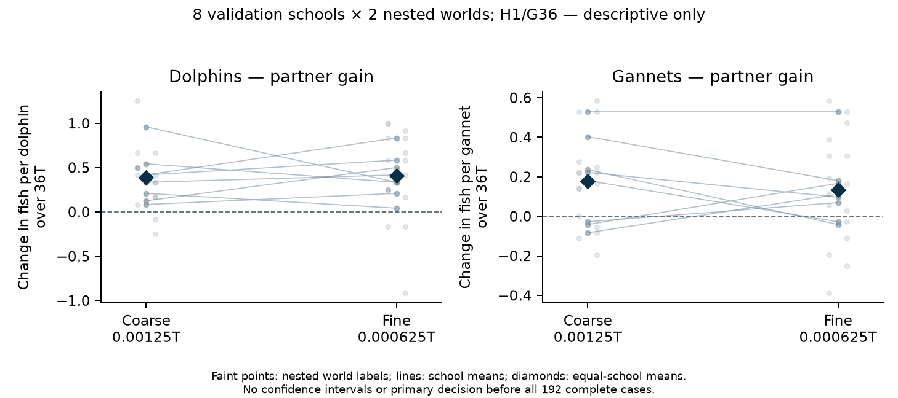

# Validation progress: first eight audited schools

**Preliminary: 8 of 16 prespecified new schools, 96 of 192 full encounters.** On the fine grid, dolphin captures increased from 357 to 435 (+21.8%) and gannet captures from 156 to 234 (+50.0%). Both species also had higher mean captures on the coarse grid. These are cumulative descriptive results, with no confidence intervals or primary decision. All remaining cases continue regardless of these signs. The current paper and notebook remain the separate completed discovery report.

This is fixed H1/G36: twelve dolphins, thirty-six gannets, 160 starting fish, q=0.7 eligible oral-contact success and nominal 36T encounters. Schools 39065501–39065508 each have two matched stochastic-world labels 71001/71002, three arms (D-only, G-only, mixed) and both grids. Labels change capture, tie and bird-target streams while readiness stays fixed by school/identity. They are nested repeats: the independent unit is the school, not sixteen worlds, individual predators or 96 executions. Discovery schools are not pooled.

## Matched food counts

Each total combines sixteen labelled encounters for that species/arm/grid. Per-individual gains first average the two labels within each school, then give all eight schools equal weight. Percentages are ratios of matched aggregate counts, not averages of school percentages. SD describes the spread of the eight school-mean gains; it is not a confidence interval.

| Grid | Species | Alone captures | Mixed captures | Change | Gain per individual over 36T | Relative change | School SD of gain |
|---|---|---:|---:|---:|---:|---:|---:|
| coarse | Dolphins | 352 | 426 | +74 | +0.385417 | +21.0% | 0.279730 |
| coarse | Gannets | 116 | 218 | +102 | +0.177083 | +87.9% | 0.219446 |
| fine | Dolphins | 357 | 435 | +78 | +0.406250 | +21.8% | 0.240649 |
| fine | Gannets | 156 | 234 | +78 | +0.135417 | +50.0% | 0.177826 |

Coarse dt is 0.00125T; fine dt is 0.000625T. The fine grid was designated primary before feeding, and both grids are retained here. Travel, failed contacts and recovery remain in the nominal 36T denominator. None of these 96 encounters depleted its fish population. The [four-panel view](../../validation_progress/primary_192_2026-11-10/prefix_96/absolute_and_partner.png) separates absolute per-animal food from the matched partner gain.

## All eight school means

Dolphin school means are positive in all eight schools on both grids, after averaging each school’s two labels. This does not mean every individual labelled encounter improved. Gannet school means are positive in five schools and negative in three on the coarse grid; six are positive and two negative on the fine grid. Both species have positive school means in 5/8 coarse and 6/8 fine comparisons. These descriptive counts are not the prespecified final criterion.

| School | Dolphin gain: coarse | Dolphin gain: fine | Gannet gain: coarse | Gannet gain: fine |
|---|---:|---:|---:|---:|
| 39065501 | +0.125000 | +0.500000 | +0.236111 | -0.041667 |
| 39065502 | +0.541667 | +0.333333 | -0.083333 | +0.111111 |
| 39065503 | +0.333333 | +0.416667 | -0.041667 | +0.166667 |
| 39065504 | +0.083333 | +0.208333 | +0.527778 | +0.527778 |
| 39065505 | +0.416667 | +0.583333 | -0.027778 | +0.069444 |
| 39065506 | +0.958333 | +0.333333 | +0.402778 | +0.180556 |
| 39065507 | +0.416667 | +0.833333 | +0.222222 | +0.097222 |
| 39065508 | +0.208333 | +0.041667 | +0.180556 | -0.027778 |

Faint points are nested labels, lines connect school means and diamonds show equal-school means. There are no confidence bars. The [school table](../../validation_progress/primary_192_2026-11-10/prefix_96/paired_school_means.csv) and [both-label table](../../validation_progress/primary_192_2026-11-10/prefix_96/nested_world_effects.csv) retain every point and sign. The [earlier48-case snapshot](VALIDATION_PROGRESS_48.md) remains unchanged as a dated record.

On the fine grid, pooled dolphin contacts increased from 537 to 641 (+19.4%) and gannet contacts from 222 to 344 (+55.0%). Dolphin launches increased from 949 to 1057 and gannet launches from 2914 to 3416. The configured contact-success probability remains q=0.7. These opportunity counts accompany the feeding gains; they do not isolate a panic or timing mechanism. The [independent arithmetic receipt](../../validation_progress/primary_192_2026-11-10/prefix_96/evidence/root_independent_arithmetic.json) retains both grids.

## Verification and remaining work

Both complete paired-block audits passed independently: block1 SHA256 `1609c4dd6d131bd95232ec3600dc428deba69d6b959eb46099fe057c4cd9a59c` and block2 SHA256 `350e6352c9b7ad1bd75d3cb61ff9886168491fcb470adbdc1f9b5a6cbed28172`. Together they verify all 96 raw/physical/private-stream/zero-start/removal records; block1 also binds all six strict 4T engineering prefixes. The frozen reporting gate checked both accepted blocks, all four completed owner phase tables and the 2,127 frozen source bindings before rendering. No unfinished school is included.

The [inspection archive](../../validation_progress/primary_192_2026-11-10/prefix_96/README.md) contains exact audited rows, phase tables and receipts, plotted data, both figures and source fingerprints. It is not a complete portable raw-simulator bundle. The saved tables can be inspected without a simulator; this reporting run used no model import, native steps or new bootstrap draws.

Eight schools and 96 encounters remain. The locked fine-grid 97.5% primary criterion is assessed only after all 192 cases and the independent FINAL audit; the final metadata-sidecar proof is also required before final publication. No setting, grid, school, interval method or stopping rule is selected from these interim signs. The [public pre-analysis plan](VALIDATION_PREANALYSIS_PLAN.md) remains unchanged.

The selected discovery setting’s 45.1% dolphin gain came from a different four-school bank with one randomness label. The current 21.8% fine-grid gain is a separate, early validation estimate, not replication of that numerical percentage. Historical discovery, older eight-school numerical checks and the new validation cohort remain distinct. This update does not establish completed validation, numerical convergence or biological generality.
